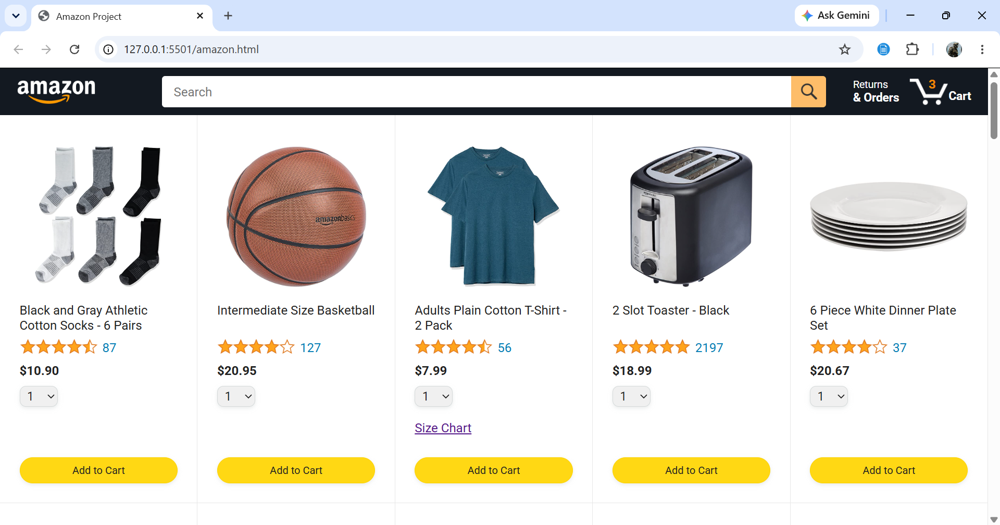
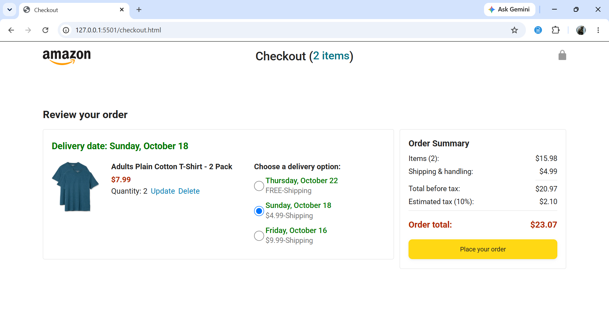
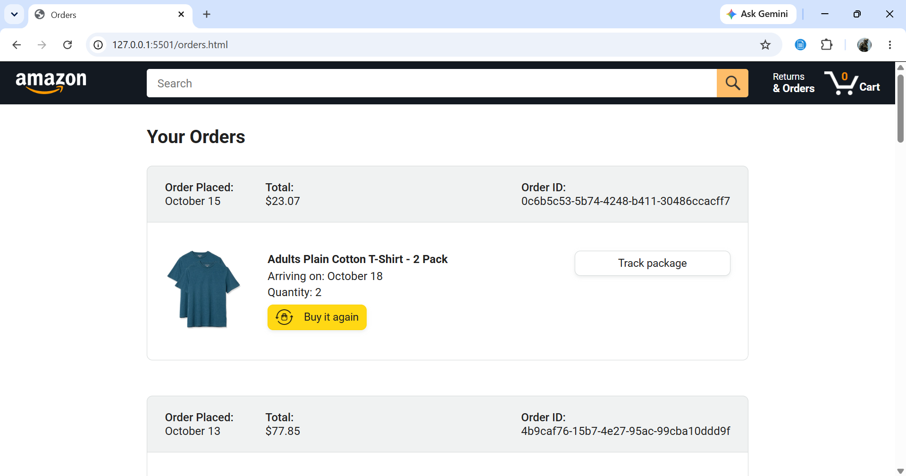
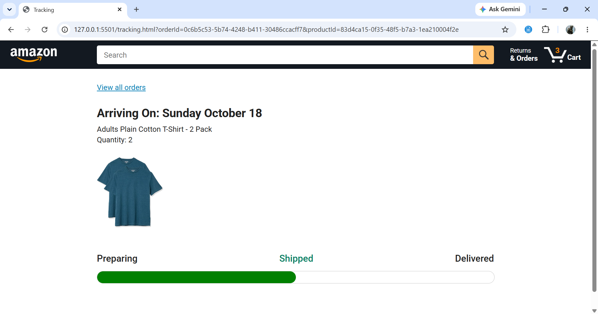

<div align="center">

# 🛒 Amazon Clone

### A complete shopping experience built with JavaScript

A front-end e-commerce application featuring cart management, checkout,
order history, and dynamic order tracking.

<br>


<br><br>

**Designed to explore real-world e-commerce functionality using vanilla JavaScript.**

</div>

---

## Overview

This project recreates the core shopping workflow of an e-commerce
platform, from browsing products to tracking placed orders.

The application uses modular JavaScript to manage cart operations,
calculate checkout totals, store order history, and dynamically
display delivery information.

Rather than focusing only on the user interface, this project explores
how multiple pages and JavaScript modules work together to create
a functional shopping experience.

## 📸 Application Preview

### 🛍️ Home Page

Browse products and add items to your shopping cart.



### 🛒 Checkout Page

Review cart items, select delivery options, and view the payment summary.



### 📦 Order History

View previously placed orders and use the Buy Again functionality.



### 🚚 Order Tracking

View product details, estimated delivery dates, and delivery progress.



## Features

### 🛍️ Product Shopping

- Browse products in a familiar e-commerce interface.
- Add products to the shopping cart.
- Manage product quantities.

### 🛒 Smart Cart Management

- Add and remove cart items.
- Update quantities dynamically.
- Select delivery options.
- Persist cart data using browser localStorage.

### 💳 Checkout Workflow

- Display an order summary.
- Calculate product totals, shipping charges, and taxes.
- Place orders through the implemented order workflow.

### 📦 Order Management

- View previously placed orders.
- Review order details and estimated delivery dates.
- Add previously purchased products to the cart using Buy Again.

### 🚚 Dynamic Order Tracking

- Open tracking information for a specific product and order.
- Display estimated delivery dates.
- Update the displayed delivery status based on the estimated date.

## Technology Stack

**Frontend**
- HTML5
- CSS3
- JavaScript (ES6+)

**JavaScript Concepts**
- Classes and object-oriented programming
- ES modules and imports/exports
- Promises and asynchronous programming
- Array methods and object manipulation
- DOM manipulation and event handling

**Browser APIs and Libraries**
- localStorage for client-side persistence
- Day.js for date formatting and calculations
- Fetch API for asynchronous product loading

**Development Tools**
- Visual Studio Code
- Git
- GitHub
- Live Server

## Application Workflow

The application follows a connected shopping workflow.

1. **Browse Products**  
   Users explore the available products and add items to their cart.

2. **Manage Cart**  
   Cart items, quantities, and delivery options are managed through
   the cart module.

3. **Checkout**  
   The checkout page calculates the order summary, including shipping
   charges and taxes.

4. **Place Order**  
   The application creates an order using its implemented order workflow.

5. **View Orders**  
   Placed orders are displayed on the orders page.

6. **Track Delivery**  
   The tracking page retrieves the selected order and product using
   URL parameters and displays the delivery information.

## Project Structure

The project is organized into separate pages, reusable modules,
and stylesheets.

```text
javascript-amazon-project/
├── data/
|   ├── cart.js
│   ├── cart-class.js
│   ├── products.js
│   ├── orders.js
│   └── deliveryoptions.js
├── scripts/
|   ├── Amazon.js
│   ├── checkout.js
│   ├── orders.js
│   ├── tracking.js
│   └── ...
├── styles/
│   └── ...
├── Amazon.html
├── checkout.html
├── orders.html
├── tracking.html
└── README.md